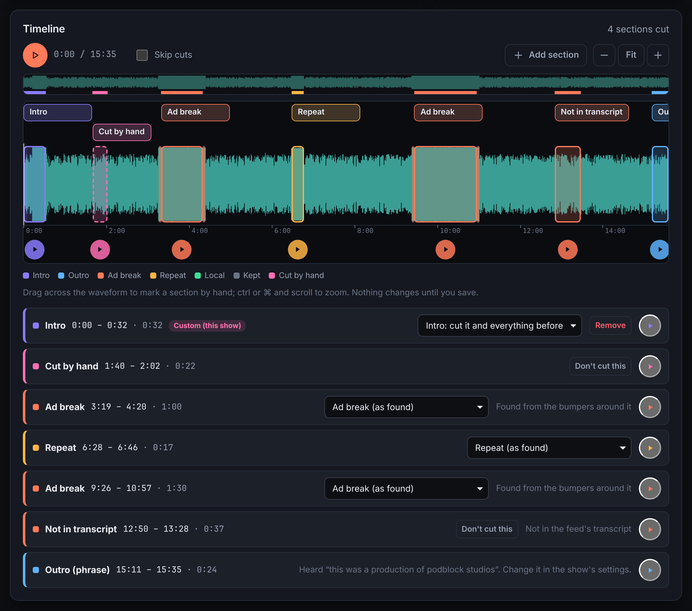
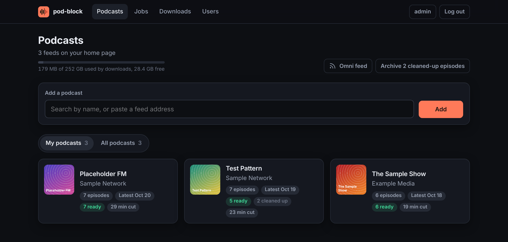
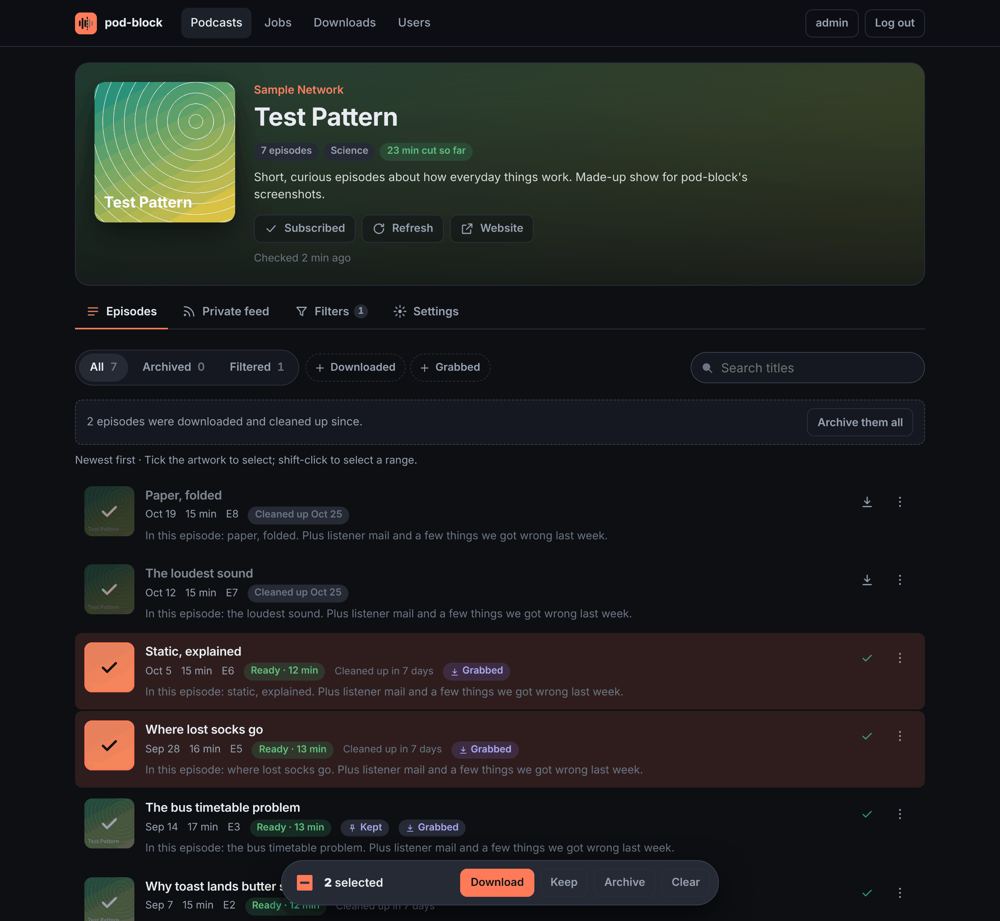
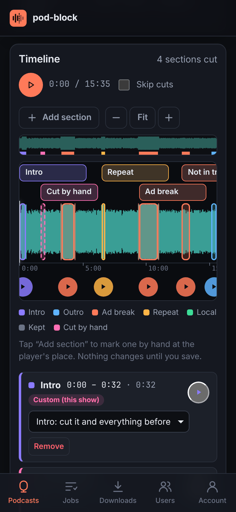

# pod-block

Podcasts with the repeats cut out. pod-block follows your podcast feeds,
finds the audio that plays in more than one episode (intros, outros, ad
reads, promos, theme music, and the short stings around ad breaks), cuts it
out of the episodes you pick, and gives you a private feed of the cut
episodes for any podcast app.

What it learns goes into one database for every feed, so an ad heard on one
show is cut from the next show that runs it, and an ad break marked by the
show's usual stings is cut whole, even when the ads in it are new.



## Getting started

### Docker

```sh
docker run -d --name pod-block -p 8000:8000 \
  -v pb-data:/data -v pb-media:/media \
  ghcr.io/dben/pod-block:latest
docker logs pod-block   # the login key, printed once on first start
```

Open <http://localhost:8000> and log in as `admin`, with the key as the
password. Then:

1. Paste a podcast's RSS feed address into the box on the home page, or
   type its name to search for it.
2. Pick a few episodes and press **Download**. Each is downloaded,
   compared with others of the show, and cut. For a new show, pod-block
   takes a few more episodes along to compare with, so the first download
   takes longest.
3. Open the show's **Private feed** tab and add that address to your
   podcast app, or scan its QR code.

`pb-data` holds the database (small; back it up) and `pb-media` the audio
(large; it can be downloaded again). Podcast apps often fetch feeds from
their own servers, so for the private feed to work, pod-block must be
reachable from the internet: put it behind HTTPS and give it its address
with `-e PODBLOCK_PUBLIC_URL=https://pods.example.com`. `WEBAPP.md` lists
the other settings.

### Kubernetes

[`deployment/`](deployment/) has an example to copy: a namespace, two
volumes, the Deployment, a Service and an Ingress. Change the lines marked
`CHANGE` (the address and the storage), then:

```sh
kubectl apply -k deployment/
kubectl logs -n pod-block deploy/pod-block | grep -A2 "API key"
```

[`deployment/README.md`](deployment/README.md) covers the login key,
storage, backups, upgrades and keeping the management pages private.

### From source

Needs Python 3.10+ and `ffmpeg` on the `PATH`.

```sh
pip install -e '.[web]'
podblock serve          # http://127.0.0.1:8000; prints a login key on first start
```

pod-block also runs from the command line, with no web app: point it at
feeds or audio files and it lists what repeats. See [`CLI.md`](CLI.md).

## The web app



- **Follow feeds.** Add a feed by address, or search Apple's podcast
  directory. Feeds refresh on their own, and a show can download new
  episodes as they come out.
- **Pick episodes.** Select episodes in the list (shift-click for a range)
  to download, keep or archive them. Filters hide episodes by title, and
  can keep "best of" and rerun episodes out of the learning.
- **Check the cuts.** Each episode has a timeline of what was cut. Play
  any part, change what a section is, or drag across the waveform to cut
  something by hand. Changes to a section apply to every episode it plays in.
- **Listen anywhere.** Each user gets a private feed of each podcast, and
  one feed of all their podcasts together.
- **Share it.** The admin adds users with passwords; each picks their own
  podcasts.
- **Stays small.** Downloads are cleaned up a week after they are cut (set
  per podcast), unless you keep them.





[`WEBAPP.md`](WEBAPP.md) describes the app in full. The screenshots show
made-up podcasts.

## Block types

A **block** is a stretch of audio that pod-block has heard in more than one
episode: a theme tune, an ad, a promo, a sting. Each block has a type, and
the type decides two things:

- **Where pod-block looks for it.** Most blocks are looked for in every
  podcast, since networks run the same ads on all their shows. A show's own
  intro and outro are looked for in that show only.
- **What gets cut.** Most blocks are cut where they play and no more. Some
  stretch to cover the audio around them, as below.

pod-block types blocks itself, and you seldom need to change them. You
change a type to tell it something it can't work out alone, such as which
tune opens the show, or to undo a mistake. In the web app, pick a type
from a section's menu on the timeline (or see [`CLI.md`](CLI.md)). A type
set by hand stays: pod-block never changes it back.

Each block belongs to the podcast it was first found in.

### Repeated

The type every new block starts with: an ad, a promo, a jingle. Looked for
in every podcast and cut where it plays.

### Intro and outro

A show's opening and closing music. Set these by hand; pod-block can't tell
an intro from any other jingle. Looked for in their own show only.

An intro is cut from the start of the episode to the end of the tune, so
the cold open or the chat before the theme goes too. An outro is cut from
the start of the tune to the end of the episode, taking the patron
thank-yous and trailers that follow. Only the first intro, in the first
half of the episode, and the last outro, in the second half, stretch; any
others are cut where they play.

Some outros are read over a music bed, and the bed rarely matches between
episodes. pod-block can find these from the sound alone (see "Outros read
over music").

### Local

Cut where it plays, like a repeated block, but looked for in its own show
only. Use it for audio this show plays that other shows might play and
want to keep, such as stock music.

### Bumpers

The short stings that open and close an ad break: "We'll be right back",
"And we're back". pod-block finds and types these itself, from short blocks
that keep turning up at the edges of runs of ads.

- **bumper-in** opens a break.
- **bumper-out** closes one.
- **bumper** is a sting a show plays at both ends.

Bumpers are looked for in every podcast. They are never cut themselves,
since hosts often talk over them. What they do is mark a break: everything
between a bumper-in and the next bumper-out is cut as one, even ads
pod-block has never heard. In shows without bumpers, a minute or more of
known ads back to back counts as a break.

### Ignored

A mistake: audio pod-block took for a repeat that you want to keep. It is
never cut, and it stays in the database so pod-block doesn't learn the same
audio again. In the web app, this is **Keep** on the timeline. Keeping an
ad break also marks its bumpers as ignored, so the break stays.

### In short

| Type | Who sets it | Looked for in | What's cut |
| --- | --- | --- | --- |
| `repeated` | pod-block (the default) | every podcast | the block |
| `intro` | you | its own podcast | from the start of the episode to the end of the first intro |
| `outro` | you | its own podcast | from the start of the last outro to the end of the episode |
| `show` | you | its own podcast | the block |
| `bumper-in`, `bumper-out`, `bumper` | pod-block, or you | every podcast | the ad break between them; the bumpers stay |
| `ignored` | you | nowhere | nothing |

## Outros read over music

Some shows end with minutes of talk over a music bed: patron names, plugs,
announcements. The talk changes every week and buries the music, so the bed
seldom matches between episodes and no block covers it. It still stands out
in the loudness floor, the level of the quietest moments: during the show it
swings as people pause and talk over each other, while under a steady bed it
holds still. With the setting on, the steady stretch at the end of each
episode is cut as an outro, through to the end. It is off by default and set
per podcast from the command line (see [`CLI.md`](CLI.md)).

On four episodes of one show it found outros of 6 to 8.5 minutes; on the two
given by hand it started at 1:02:19 (given: 1:02:19) and 1:06:31 (given:
around 1:07:32). It found none in the eight episodes of other shows tried.
A loudness curve is stored with each fingerprint, so this needs no audio.

## How it works

1. **Fingerprint.** Each episode is decoded with ffmpeg and turned into a
   spectrogram. The strongest peaks are kept, each is paired with a few peaks
   just after it, and each pair becomes a 32-bit hash stamped with its time.
   This survives re-encoding, volume changes and moderate noise.
   - By default, audio is decoded at 16 kHz and 4-8 kHz is fingerprinted as
     a band of its own. Speech sits mostly below 4 kHz, so music played
     under a host's voice often only shows up there. On the test episodes
     this nearly tripled how much of a music bed under speech was found.
   - Picking peaks within several bands separately (off by default) found
     under a second more on the same test, for 8% more hashes.
   - A store keeps the settings it was created with; fingerprints from
     different settings never match.
2. **Compare.** Each new episode is compared with its comparison set (see
   "Comparing"). Matching hashes from the same audio all sit at one time
   offset. Runs of densely matched seconds at least 1.5 s long are shared
   audio. Runs under 10 s must turn up at least 3 times to be kept.
3. **Store.** Each shared run becomes a block, unless stored blocks already
   cover it. Long blocks are cut where other episodes match only part of them
   (an ad break splits into single ads), and slivers that always play inside
   a longer block are dropped.
4. **Bumpers.** Matches within 8 s of each other form a group. A block whose
   matches are short (under 10 s, and no longer than 20 s stored) and that
   keeps opening groups becomes a `bumper-in`; one that keeps closing them a
   `bumper-out`. Tags are worked out afresh on each run until a bumper has
   sat at a break edge 6 times in 3 episodes; it is then confirmed and keeps
   its tag.
5. **Breaks.** A break runs from a bumper-in to the next bumper-out (within
   10 minutes), even when the ads between them are all new. Some shows play
   one sting on both sides of a break (`bumper`); a pair of those only counts
   when known ads play between them, so the pairing can't slip out of step.
   A lone bumper-in or bumper-out still marks one end, and reaches over up to
   90 s of new ads to known ones. Shows without bumpers get breaks from 60 s
   or more of known blocks back to back.

## Comparing

A new episode is compared with the 4 episodes of the same show closest to it
in publish date, not the newest ones: people hop around a back catalogue, and
the ads that ran when an episode came out sit in its neighbours. It is also
compared with the closest episode of each other show, if published within 14
days, to catch network ads. Only those episodes are rescanned afterwards, so
a request costs the same however big the store grows.

## Size and speed

Measured on one CPU core:

| | |
| --- | --- |
| Fingerprinting | about 30 s per hour of audio, about 0.3 GB of memory whatever the length |
| Fingerprint file | about 2 MB per hour of audio |
| Stored block | about 60 KB per minute of block |
| Adding one 1-hour episode (download aside) | about 6 s after fingerprinting |
| Report on a stored episode | about 1 s |

The web app clears out old downloads, fingerprints and blocks no longer
heard on its own ("Retention" in `WEBAPP.md`); from the command line,
`prune` does it ("Keeping it small" in `CLI.md`).

## Data

The database and fingerprints live in the data folder
(`PODBLOCK_DATA_DIR`, default `./podblock-data`; `/data` in the container):

| Path | What |
| --- | --- |
| `podblock.sqlite` | podcasts, episodes, blocks with their hashes, occurrences, saved reports, settings |
| `fingerprints/*.npz` | full fingerprint of each episode, so comparisons never decode again |
| `audio/` | episodes the command line downloaded |

The web app keeps its audio apart, in the media folder (`PODBLOCK_MEDIA_DIR`).

```
settings(key, value)                         -- schema version, fingerprint setting
podcasts(id, name, feed_url, outro_bed)
episodes(id, guid, podcast_id, title, pub_date, audio_url, audio_path, fingerprint_path, duration)
segments(id, source_episode_id, podcast_id, source_start, source_end, label, type, type_manual,
         hashes, times, created_at, last_seen)  -- hashes: packed uint32; times: packed int32,
                                                -- 32 ms frames from the block start
occurrences(segment_id, episode_id, start, end, segment_start, hits)
compared_pairs(a_id, b_id)
reports(episode_id, created_at, report)      -- a report's sections, as JSON
users(id, username, password_hash, is_admin, created_at)  -- web app logins
user_episodes(user_id, episode_id, archived, kept)        -- web app, per user
```

The web app adds its own columns to `podcasts` and `episodes` (feed metadata,
raw XML); `WEBAPP.md` lists them.

## Tests and lint

```sh
uv sync --all-extras     # or: pip install -e '.[web,test,dev]', unpinned
uv run pytest -m "not slow"   # about 30 seconds
uv run pytest                 # everything, about 5 minutes: the slow tests cut real audio and start workers
uv run ruff check .
```

`uv.lock` pins every package to the versions CI tests and the Docker image
ships, for each Python and platform pod-block supports; `pyproject.toml` keeps
the ranges it works with. `uv lock --upgrade` updates the pins, to releases at
least a week old (`exclude-newer` in `pyproject.toml`), and Dependabot opens
pull requests for the same each week (`.github/dependabot.yml`). Shared test
helpers are in `tests/fakes.py`, and the fixtures built on them in
`tests/conftest.py`.
