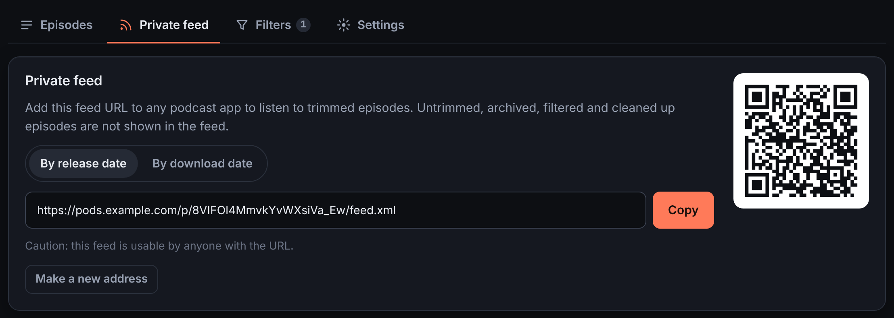
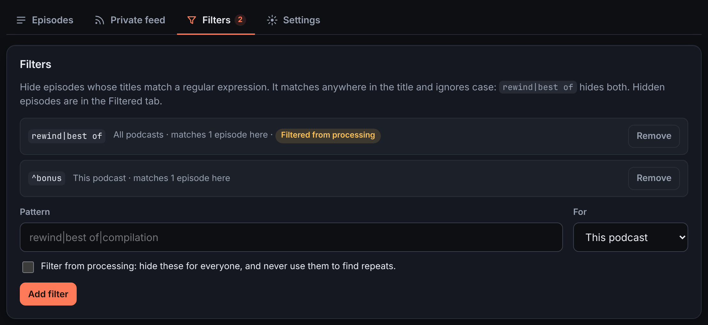
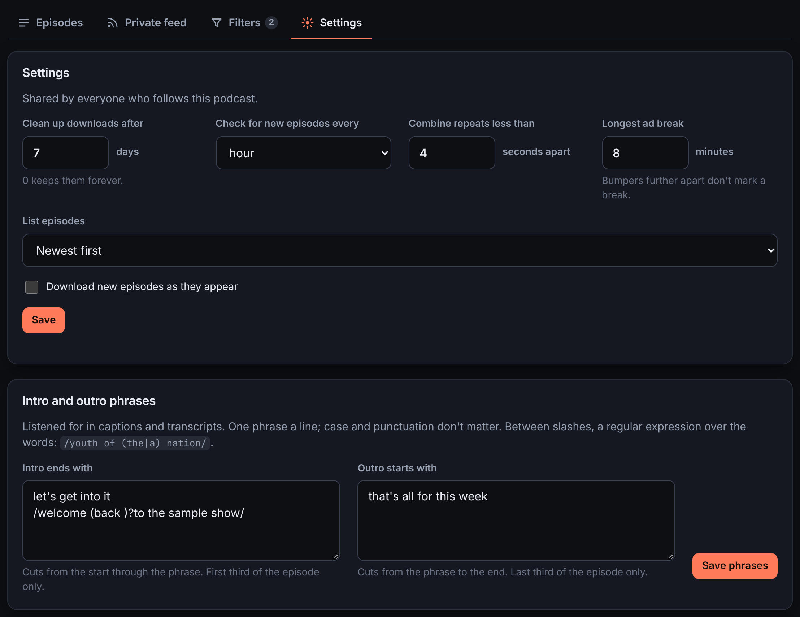
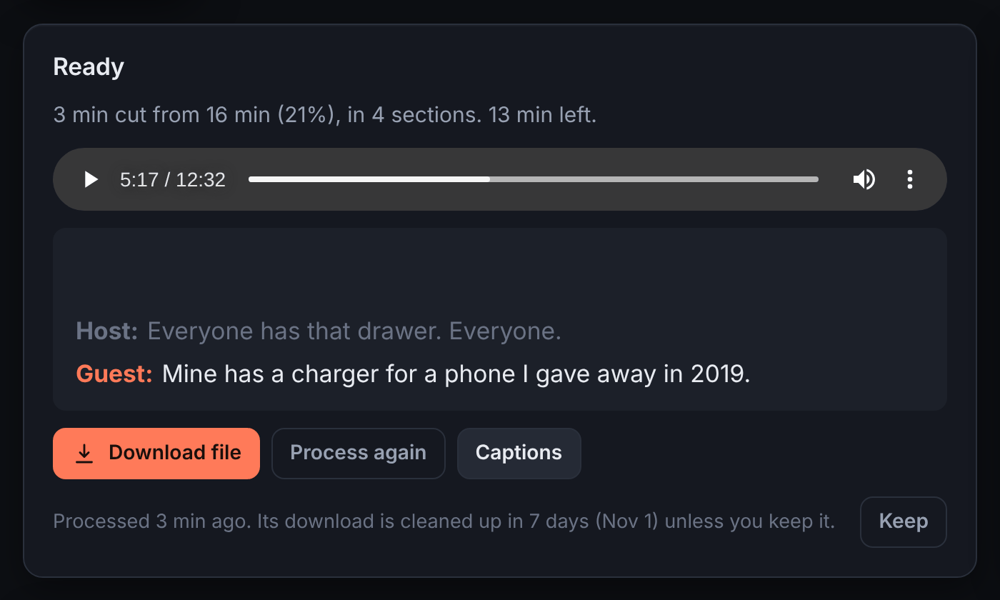

# pod-block

Podcasts with the repeats cut out. pod-block follows your podcast feeds,
finds the audio that plays in more than one episode (intros, outros, ad
reads, promos, theme music, and the short stings around ad breaks), cuts it
out of the episodes you pick, and gives you a private feed of the cut
episodes for any podcast app.

Everything it learns goes into one database shared by every feed. An ad
heard on one show is cut from the next show that runs it, and an ad break
marked by the show's usual stings is cut whole, even when the ads in it are
new.


## Install

### Docker

```sh
docker run -d --name pod-block -p 8000:8000 \
  -v pb-data:/data -v pb-media:/media \
  ghcr.io/dben/pod-block:latest
docker logs pod-block   # the login key, printed once on first start
```

Open <http://localhost:8000> and log in as `admin`, with the key as the
password.

`pb-data` holds the database (small; back it up) and `pb-media` the audio
(large; it can be downloaded again).

### Kubernetes

[`deployment/`](deployment/) has an example to copy: a namespace, two
volumes, the Deployment, a Service and an Ingress. Change the lines marked
`CHANGE` (the address and the storage), then:

```sh
kubectl apply -k deployment/
kubectl logs -n pod-block deploy/pod-block | grep -A2 "API key"
```

[`deployment/README.md`](deployment/README.md) covers the login key,
storage, backups, upgrades and keeping the management pages private.

### From source

Needs Python 3.10+ and `ffmpeg` on the `PATH`.

```sh
pip install -e '.[web]'
podblock serve          # http://127.0.0.1:8000; prints a login key on first start
```

### Reaching it from your podcast app

Podcast apps often fetch feeds from their own servers, so for private feeds
to work pod-block has to be reachable from the internet. Put it behind
HTTPS and set:

| Setting | Value |
| --- | --- |
| `PODBLOCK_PUBLIC_URL` | the address apps use, e.g. `https://pods.example.com` |
| `PODBLOCK_SECURE_COOKIES` | `true`, so the login cookie only travels over HTTPS |

With Docker, pass them as `-e PODBLOCK_PUBLIC_URL=…`. "Settings" in
[`WEBAPP.md`](WEBAPP.md) lists the rest.

## Using it

### 1. Add a podcast

Paste a feed address into the box on the home page, or type a show's name to
search Apple's podcast directory. Each podcast gets a card with how many
episodes are ready and how much has been cut. The bar under the heading
shows how much space downloads take.


### 2. Download episodes

Open a show and pick episodes. Click an episode's artwork to select it, and
shift-click another to select everything between. On a phone, tap the
artwork or press and hold a row. Then press **Download** in the bar at the
bottom, or use the download button on a single row.

The first download of a new show takes longest. pod-block needs four
episodes of a show to compare, so it brings the next few along and cuts
those too.

Each row shows where its episode is: queued, downloading, cutting, ready
with its new length, or cleaned up. Above the list:

- **All**, **Archived** and **Filtered** are the lists. Archive episodes
  you're done with to clear them out of the way.
- **Downloaded** and **Grabbed** narrow whichever list is open, to episodes
  downloaded at some point, or ones you've had through your feed or played
  here. Turn on both for episodes that are both.
- **Search titles** filters as you type.

**Keep**, in a row's menu or the selection bar, stops an episode from being
cleaned up.


### 3. Check the cuts

Open an episode to see its timeline. Each cut section is drawn in its type's
colour, with a card below it. Click the waveform to play from there, or a
section's play button to hear it with two seconds of lead-in. **Skip cuts**
plays the episode the way your podcast app will.

Change a section from its menu:

| Choice | Does |
| --- | --- |
| Intro: cut it and everything before | marks the show's theme tune; the cold open goes too (this show) |
| Outro: cut it and everything after | marks the closing tune; the thank-yous and trailers after it go too (this show) |
| Keep (this show) | leaves it in this show's episodes |
| Not a repeat | never cuts it, in any show |

pod-block can't tell an intro from any other jingle, so mark the intro and
outro once per show. They're then found in every episode.

To cut something it missed, drag across the waveform (on a phone, tap **Add
section**). Choose whether to cut it from this episode only or catch it in
the show's other episodes too. Nothing changes until you press **Save and
re-cut**.


[`HOW-IT-WORKS.md`](HOW-IT-WORKS.md) explains each block type and how ad
breaks are found.

### 4. Listen

Each show's **Private feed** tab has your feed's address, with **Copy** and
a QR code to scan into your podcast app. It lists the cut episodes,
leaving out ones you archived or filtered. **By download date** gives a
second address that lists them newest downloaded first, which suits working
through a back catalogue.

The **Omni feed** button on the home page gives one feed of every podcast on
your home page.

Anyone with a feed's address can use it. If one gets out, **Make a new
address**.



### 5. Filter episodes

The **Filters** tab hides episodes whose titles match a pattern. Patterns
are regular expressions, matched anywhere in the title and ignoring case,
so `rewind|best of` catches both. A filter covers one podcast or all of
them; hidden episodes move to the Filtered list.

Tick **Filter from processing** for compilations, "best of" and rewind
episodes. These replay whole earlier episodes, so comparing them would
mark everything in them as a repeat. A filter from processing hides its
episodes for everyone and keeps them out of finding repeats. If pod-block
already learned from one, it forgets what that episode taught it. You can
still download one by hand, and it's cut using what was learned elsewhere.



### 6. Tune a show

The **Settings** tab is shared by everyone who follows the show.

| Setting | Default | |
| --- | --- | --- |
| Clean up downloads after | 7 days | 0 keeps them for good |
| Check for new episodes every | hour | 15 minutes to a week |
| Combine repeats less than | 4 seconds apart | so a new ad between two known ones goes too |
| Longest ad break | 8 minutes | bumpers further apart don't mark a break |
| List episodes | newest first | |
| Download new episodes as they appear | off | |

**Intro and outro phrases** cut by what's said, for shows whose intro isn't
a fixed tune. List phrases that end the intro or start the outro, and
pod-block cuts up to or from them. Write a phrase between slashes for a
regular expression. Phrases need a transcript: the feed's own, or captions
(below).



### 7. Captions (optional)

Run the transcription service from [`whisper/`](whisper/) beside pod-block
and set `PODBLOCK_WHISPER_URL`. Downloads whose feed has no timed
transcript then get captions, made on the CPU. They show under the
episode's player, as a feed's own timed transcript does, and go into your
private feed, timed to the cut audio.
With speakers turned on, each line is lettered by who says it.

Shows that put their ads in after recording often have a feed transcript
that leaves the ads out. With captions on, pod-block compares the two and
cuts the speech the feed's transcript doesn't have. A checkbox in the show's
Settings turns this off.



### Sharing and upkeep

- **Users.** The admin adds people on the Users page, each with a password.
  Everyone picks the podcasts on their own home page and gets their own
  feeds, archive and filters. Downloads, cuts and show settings are shared.
- **Jobs.** The Jobs page shows what's running and queued, with progress,
  and lets you cancel or retry.
- **Downloads.** The admin's Downloads page lists every file on disk with
  its size. Delete one to free space; it can be downloaded again.
- **Clean-up.** Downloads go after the show's clean-up time. An episode
  everyone has archived or filtered goes after a day.

## Command line

`podblock` also runs on its own, with no web app: point it at feeds or audio
files and it lists what repeats. See [`CLI.md`](CLI.md).

## More

| File | Covers |
| --- | --- |
| [`HOW-IT-WORKS.md`](HOW-IT-WORKS.md) | block types, how repeats and ad breaks are found, speed, the database |
| [`WEBAPP.md`](WEBAPP.md) | the web app in full: settings, features, design, routes |
| [`CLI.md`](CLI.md) | the command line |
| [`deployment/README.md`](deployment/README.md) | running on Kubernetes |
| [`whisper/README.md`](whisper/README.md) | the captions service |

The screenshots show made-up podcasts with made-up audio.

## Development

```sh
uv sync --all-extras     # or: pip install -e '.[web,test,dev]', unpinned
uv run pytest -m "not slow"   # about 30 seconds
uv run pytest                 # everything, about 5 minutes: the slow tests cut real audio and start workers
uv run ruff check .
```

`uv.lock` pins the versions CI tests and the image ships; `pyproject.toml`
keeps the ranges. `uv lock --upgrade` updates the pins to releases at least
a week old, and Dependabot does the same weekly. Test helpers are in
`tests/fakes.py`, fixtures in `tests/conftest.py`.
